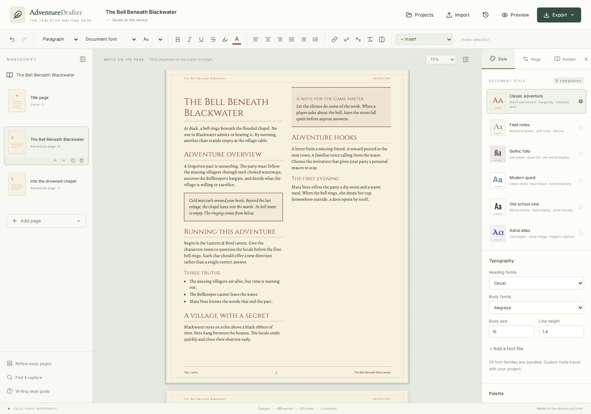

# Adventure Drafter

A local-first, page-first adventure publishing desk for D&D and other tabletop RPGs. Write directly on styled paper with a structured rich-text editor. Markdown is an import format rather than the editing surface.



## Run locally

Requires Node.js 22 or newer.

```sh
npm ci
npm run dev
```

Open the URL printed by Vite. For a local-only development server use `npm run dev -- --host 127.0.0.1`.

```sh
npm run build
npm test
npm run check:architecture
npx playwright install chromium
npm run test:e2e
npm run check:worker
```

## Deploy on Cloudflare Workers

Connect `mmmbeer/adventure-drafter` in Cloudflare **Workers & Pages → Create → Import a repository**. Use:

- Root directory: repository root
- Build command: `npm run build`
- Deploy command: `npx wrangler deploy`
- Production branch: `main`

Cloudflare installs dependencies from `package-lock.json`. The build emits `dist/`. `wrangler.jsonc` serves these assets from a Worker with SPA fallback. There is no D1 database, account system, backend document service, or required secret. Local development and exports work without a server API.

For a manual deployment after authenticating with Cloudflare:

```sh
npm run deploy
```

## Writing and layout

- Direct-on-page Tiptap/ProseMirror editing, headings 1–9, inline typography, alignment, links, lists, highlights, sub/superscript, paragraph spacing/indentation and keep-with-next.
- Two columns by default, with one/two/three columns per document or page, column breaks and full-width paragraphs/headings.
- Letter, A4 and A5 paper with configurable margins, gutter, type size, line height, colors, running headers, footers and page numbering.
- Six content-preserving visual templates with separate heading/body families. Twenty bundled open-source families plus system fonts and user-provided WOFF/WOFF2/TTF/OTF files.
- Read-aloud boxes, asides, encounter/treasure callouts, editable creature stat blocks, and resizable tables with row/column insertion/removal, headers, cell merging and splitting.
- Uploaded, pasted, dropped or URL-imported images. Percentage sizing, left/right text wrapping, alt text, optional captions and multiply blending. Per-page background art and opacity.
- Title pages, live heading-based contents, and a keyword index. Add keywords directly or index a text selection. Generated references account for continued contents/index sheets. The index uses case-insensitive substring matching.
- Page cards can be selected, dragged, moved, duplicated and deleted. Body overflow moves forward automatically. **Reflow body pages** closes gaps in automatic continuations after deletions or style changes. Explicit page breaks and pages with background art form boundaries. An individual unbreakable block that exceeds a column must be shortened/resized.
- Find and replace across text runs, print preview, browser printing and per-page undo/redo. Find does not join matches across differently formatted text runs. Named versions are the document-wide restore mechanism.

## Local saves and portable projects

IndexedDB stores manuscripts and named versions asynchronously. The current draft autosaves after a short debounce. Projects are listed in the Projects dialog. Named versions are explicit checkpoints and restoring one first retains the outgoing draft.

**Download project backup** creates an `.adventure.json` file containing the complete structured document, embedded images and custom fonts. Import it on another device to continue editing. Browser storage is local to the current origin/profile and can be cleared or evicted. Keep downloaded backups for important work. The app requests persistent browser storage when a project is created or backed up, where supported.

Image inputs support PNG, JPEG, WebP and GIF up to 15 MB each. URL images are fetched and embedded in the browser. Hosts must permit cross-origin requests. No server-side image proxy is used. Custom fonts are limited to 8 MB and imports to 80 MB.

## Imports

- **Markdown:** CommonMark/GFM paragraphs, headings, emphasis, lists, tables, links and images, through Marked and an HTML sanitizer.
- **Homebrewery:** Markdown, `\page`, `\column`, common v3 `{{note}}`, `{{descriptive}}`, `{{readaloud}}` and `{{monster}}` blocks. Arbitrary custom CSS, exact Homebrewery themes, absolute positioning and unsupported directives are not reproduced. The import report makes review requirements explicit.
- **Word:** `.docx` via Mammoth, preserving semantic text, heading levels, lists, tables and embedded images. Word-specific floating shapes, geometry and background art require review. Convert legacy `.doc` files to `.docx` first.
- **Adventure Drafter JSON:** validated, sanitized structured projects. Import creates a distinct local project rather than overwriting the source.

Imports keep the outgoing project and make a named checkpoint. Imported HTML is sanitized and arbitrary scripts, frames and forms are removed. There are no remote font requests or runtime CDN dependencies.

## Publishing exports

| Edition                     | Layout fidelity                                                                                                                  | Editable/selectable text                                      |
| --------------------------- | -------------------------------------------------------------------------------------------------------------------------------- | ------------------------------------------------------------- |
| PDF                         | Exact page canvas at 2.5× resolution, including art and fonts                                                                    | Page images, not selectable text                              |
| DOCX — exact appearance     | One full-page image per Word page                                                                                                | Page images, not editable text                                |
| DOCX — editable             | Structured headings 1–9, paragraphs, inline formatting, lists, links, tables, boxed blocks, images, sections/columns and footers | Editable; Word can reflow layout and substitute missing fonts |
| Browser print / Save as PDF | Browser print rendering, with CSS backgrounds enabled and browser headers/footers disabled                                       | Selectable text and links                                     |
| Project JSON                | Lossless editable source for this app                                                                                            | Full editor data                                              |

Exports stop with an actionable message if an image cannot be fetched or content still overflows. Exact-appearance exports use the same visible page DOM. They are deliberately flattened to make PDF/DOCX layout consistent. The editable DOCX is a separate publishing choice, not a promise of identical Word pagination. Custom fonts are not embedded in editable DOCX. Contents/index references in editable DOCX are the editor's static page references and should be refreshed manually if Word reflows the file.

## Architecture

- `src/lib/types.ts`, `documents.ts`, `templates.ts`, `references.ts`, `validation.ts`: versioned schema, starter content, styling, generated references and validation
- `src/lib/editor.ts`: rich-text schema, layout attributes, sanitization and safe node splitting
- `src/components/PageEditor.tsx`: page canvas, inline editor and measured overflow handling
- `src/lib/storage.ts`: IndexedDB project/version transactions
- `src/lib/import.ts`: lazy-loaded format adapters
- `src/lib/export.ts`: portable source and appearance-preserving publishing
- `src/lib/export-editable.ts`: semantic Word conversion
- `src/components/Toolbar.tsx`, `Inspector.tsx`, `Modal.tsx`: editing controls
- `src/App.tsx`: workspace composition
- `src/state/`: local draft lifecycle, workspace state, page editing, media, import and publishing actions
- `src/components/dialogs/`: feature-specific dialog bodies and pinned actions
- `src/styles/`: focused style modules
- `scripts/check-architecture.mjs`: enforces the 500-line source limit and custom-dialog rules during every build

The editor follows the direct-preview and content/style separation patterns of DND News, using ProseMirror transactions instead of ad-hoc `contenteditable` mutations. Rendering and editing share one document model. Large import/export libraries are loaded on demand. Bundled fonts are same-origin assets with their license texts in `/licenses/`.

## Validation

Unit tests cover generated references, continued-page accounting, safe rich-text splitting, all nine heading levels, sanitization, Markdown tables and Homebrewery constructs. Browser tests cover writing, template changes, local reload recovery, project round trips, long-document pagination without text loss, all publishing downloads, editable Word re-import, high headings, image insertion and wrapping. Additional checks cover narrow layouts, all three shared modal sizes, pinned headers/footers, Escape dismissal and native file selection.
